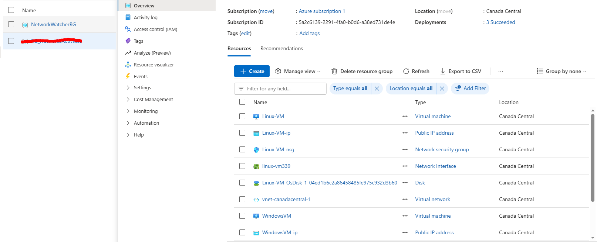
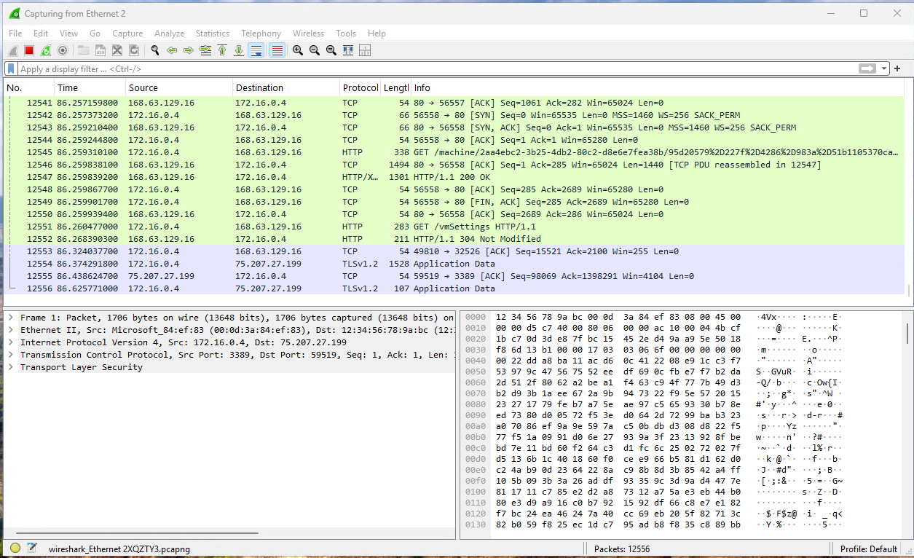
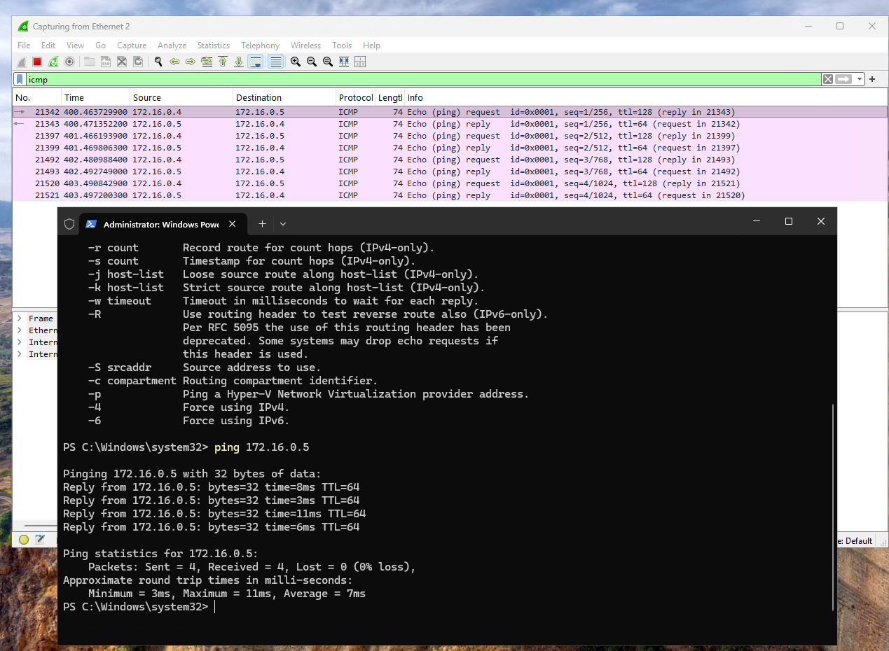
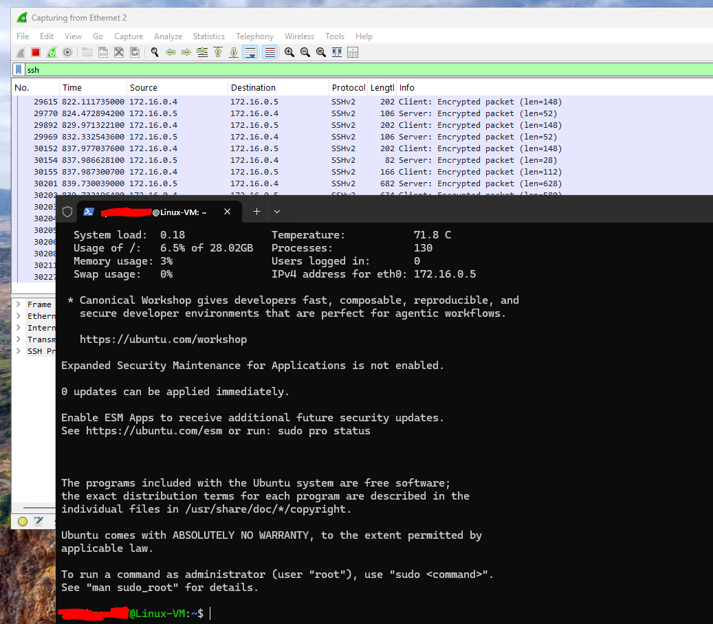

<h1>Azure Network Protocol/Networking Capture</h1>

<h1>Networking - Accessing and Configuration</h1>
This tutorial outlines the initial process of setting up Virtual Machines and accessing network features across Microsoft and Linux. 

<h2>Environments and Technologies Used</h2>

- Microsoft Azure (Virtual Machines/Compute)
- Remote Desktop
- Internet Information Services (IIS)
- Wireshark

<h2>Operating Systems Used </h2>

- Windows 11</b> (25h2-pro)
- Linux Ubuntu </b> (24.04)

<h2>Post-VM Configuration Objectives</h2>

- Establish VM for Windows and Linux OS
- Insure Windows and Linux VM are established to a network
- Establish connection/monitoring network of both the Windows VM and Linux machine.
- Establish ability to access Linux through Powershell network 

<h2>Configuration Steps</h2>

First setup your Virtual Machines with the desired Operating System(s) in mind. For this example I have chosen to use both Microsoft 11 pro OS and Linux Ubuntu (v24).
 

  This is all a test to make sure traffic is connected between VM's using Wireshark. To clarify the network connection on Linux VM I isolated the capture to icmp to monitor the ping requests only

 

Now that we have access to the Linux VM, we can now access network capabilities using SSH connection and monitor it on wireshark.
  With this we can do various things just from Windows Powershell, like creating a file on the desktop to connecting and troubleshooting network settings.
  Also allowing us to monitor SSH, DHCP, DNS, and RDP traffic.
  Note this was only used to demonstrate cross OS platform capabilities, this can be replicated as a Win <==> Win platform.

 
